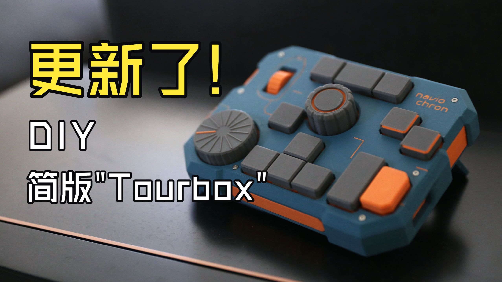

# Navio Chron Firmware

[](LICENSE)

为 [Navio Chron](https://github.com/Cityforest2000/Navio-Chron) 开源剪辑键盘编写的独立固件（ESP32-S3）。支持 USB / 蓝牙双模连接、多套动态预设，并附带一套完整的浏览器工具链：刷写固件、编辑键位、OTA 升级全部在网页中完成，主机端无需安装任何软件。

**在线工具**（需桌面版 Chrome / Edge）：

- 预设编辑器：<https://isilcala.github.io/Navio-Chron-Firmware/>
- 固件刷写与升级：<https://isilcala.github.io/Navio-Chron-Firmware/firmware/>

<!-- TODO: 成品图 / 使用演示 GIF -->

## 关于硬件

Navio Chron 由 B 站 UP 主 **火星是个喵武士**（GitHub：Cityforest2000）设计并开源，是一款基于 ESP32-S3 的剪辑小键盘：12 颗带 RGB 的热插拔按键、两个旋钮编码器与一个滚轮，支持锂电池供电，可用于视频剪辑与 iPad 绘画。

[](https://www.bilibili.com/video/BV1yPY76uEjM)

制作键盘本体的相关资源：

- 硬件制作教程（B 站）：<https://www.bilibili.com/video/BV1yPY76uEjM>
- 硬件仓库（含 BOM）：<https://github.com/Cityforest2000/Navio-Chron>
- PCB 工程（立创开源硬件平台）：<https://oshwhub.com/cityforest/>
- 3D 打印外壳模型（MakerWorld）：<https://makerworld.com.cn/zh/models/2956237-navio-chron-50kuai-diyyi-ge-he-tourboxlei-si-gong>

本固件为独立实现，未复用原仓库代码，仅参考其公开的引脚定义。

## 特性

- **免编译的网页配置**：预设编辑、固件刷写、OTA 升级均通过 WebHID 在浏览器中完成，修改键位不需要重新编译固件
- **开箱即用的模板库**：32 套官方预设，覆盖剪映、CapCut、万兴喵影、必剪、Premiere Pro、DaVinci Resolve、Final Cut Pro、After Effects、Blender、Photoshop、Lightroom Classic、Illustrator、Capture One、Clip Studio Paint、Krita（Windows / macOS），另有 iPad 端 Procreate 与通用 F13 宏模板
- **USB / 蓝牙双模**：插入 USB 自动切换有线；蓝牙固定 3 个频道，最多绑定 3 台主机，组合键切换，无需重新配对
- **键盘自包含**：预设与切换逻辑保存在键盘存储中，主机端无驱动、无常驻程序，换机即插即用
- **灯光**：10 种按键灯效（reactive、呼吸、彩虹流动、走马灯等，含关闭模式），3 颗状态灯分别指示预设、连接与低电量
- **电源管理**：电池电压估算，蓝牙模式下向系统上报电量；无线无输入 5 分钟关闭按键灯、15 分钟进入深睡，任意键唤醒
- **可靠升级**：A/B 双槽 OTA，SHA-256 校验，新固件自检失败自动回退；BOOT / ROM 救援路径不影响已安装预设

## 快速开始

准备：装好的 Navio Chron 键盘 + 桌面版 Chrome 或 Edge。

1. **刷固件**：打开[固件页](https://isilcala.github.io/Navio-Chron-Firmware/firmware/)，键盘断电后按住侧键插入 USB（或按住模块 BOOT 键 3 秒）进入下载模式，按页面引导刷入
2. **安装预设**：打开[预设编辑器](https://isilcala.github.io/Navio-Chron-Firmware/)，连接设备，从模板库选择并安装（键盘最多保存 6 套预设）
3. **开始使用**：USB 即插即用；使用蓝牙则长按侧键 5 秒进入配对，在系统蓝牙设置中连接"Navio Chron"

任何状态下的通用兜底：按住 BOOT 键插入 USB。

## 使用参考

### 侧键手势

| 手势 | 作用 |
|---|---|
| 短按 | 切换到下一套预设 |
| 长按 5 秒 | 当前频道配对 / 替换主机（配对成功后生效） |
| 侧键 + K1 / K2 / K3 | 选择蓝牙频道 1 / 2 / 3 |
| 断电按住侧键插 USB，或复位时按住 | 进入下载模式 |

侧键为全局功能键，不占用可映射槽位。

### 输入映射

12 颗按键、中央旋钮与大旋钮按压、滚轮下压，及 3 个编码器的正反转，共 21 个可映射槽位。动作类型包括快捷键（可带 Ctrl / Shift / Alt / Win 修饰键）、多媒体控制、鼠标滚轮。预设携带平台标记（Windows / macOS / iPad），编辑器按平台区分显示；macOS 的 Cmd 对应 Win 修饰键。

### 灯效

10 种灯效均可在编辑器中预览动画后设置：

| 模式 | 效果 |
|---|---|
| reactive / reactiveRandom | 按下亮起、松开渐隐（固定色 / 随机色） |
| follow | 常亮显示预设主题色 |
| breath / breathRandom | 呼吸（主题色 / 随机色） |
| colorCycle / rainbowFlow | 色相循环 / 彩虹流动 |
| marquee / rainbowMarquee | 走马灯 / 彩虹走马灯 |
| off | 关闭 |

### 状态灯

| 灯 | 含义 |
|---|---|
| LED0 | 当前预设的主题色，切换预设即变色 |
| LED1 | 绿常亮 USB；蓝常亮蓝牙已连接；蓝快闪配对中；橙慢闪无线待连接 |
| LED2 | 红慢闪低电量（约 5%） |

### 电源

锂电池供电，模块自带充电电路。充电时电量读数偏高属正常，拔线数秒后恢复。无线模式下无输入 5 分钟关闭按键灯（状态灯保留），15 分钟进入深睡；深睡后首次按键仅用于唤醒、不发送输入。USB 模式灯光常亮、不睡眠。

### 升级与救援

网页 OTA 将新固件写入备用槽，自检通过后切换，失败自动回退。救援路径依次为：网页 OTA → 按住侧键上电（或 BOOT 长按 3 秒）→ 按住 BOOT 插 USB 完整重刷。以上路径均不影响已安装预设。编辑器连接设备时会检查固件版本并提示可用更新。

### 预设导入导出

预设可导出为 `.navio.json` 文件或文本，导入时自动校验；官方模板库位于 [editor/presets/](editor/presets/)，一套模板一个 JSON 文件。

## 常见问题

**Q：需要什么浏览器？**

A：桌面版 Chrome 或 Edge（WebHID 限制）。Safari、Firefox 及移动端浏览器不支持网页连接设备。

**Q：电池供电下拔出 USB，为何没有切回蓝牙？**

A：当前硬件无 VBUS 检测，热拔线不触发切换，复位或重新上电即可恢复蓝牙。

**Q：充电时电量显示为何偏高？**

A：充电电压抬高采样读数，充满拔线后数秒恢复。

**Q：模板键位与我的软件不一致怎么办？**

A：模板基于各软件官方默认快捷键，版本间可能存在差异，可在编辑器中调整后导出分享。

**Q：按键无响应？**

A：设备可能处于深睡，首次按键仅用于唤醒，再次按压即正常。

## 已知限制

- 电池供电下热拔 USB 不自动切回蓝牙（硬件无 VBUS 检测）
- 整机续航尚未实测，暂不提供时长数据
- 各软件模板键位仍在实测调整中
- 蓝牙连接时 BOOT 长按 3 秒偶尔无法进入下载模式，可改用按住 BOOT 插 USB

## 开发

使用 VS Code + PlatformIO，默认环境 `navio_chron`：

```bash
pio run                 # 编译
pio run -t upload       # 烧录
python tools/ota_upload.py .pio/build/navio_chron/firmware.bin   # 对运行中设备 OTA 升级
python tools/make_release.py                                     # 生成本地发布包
node tools/build_templates.js                                    # 重新生成模板索引
node --test editor/*_test.js tools/probe/*_test.js               # 运行测试
```

新增预设模板：在编辑器中导出 `.navio.json` → 放入 `editor/presets/` 并补充 metadata → 运行 `build_templates.js` → 提交 PR。

构建环境、代码结构与协议文档详见 [AGENTS.md](AGENTS.md) 与 [docs/](docs/)；技术决策及理由见 [docs/DECISIONS.md](docs/DECISIONS.md)。

## 许可证

[GPL-3.0](LICENSE)。任何人可免费使用与修改；基于本项目的修改在分发时须以相同许可证开源；闭源商用请联系作者获取授权。

## 致谢

- [Navio Chron — 火星是个喵武士 / Cityforest2000](https://github.com/Cityforest2000/Navio-Chron)：硬件设计
- [HijelHID_BLEKeyboard](https://github.com/HijelHub/HijelHID_BLEKeyboard)（Apache-2.0）：HID 描述符与 BLE 实现参考
- [StyleKit — Neumorphism 风格指南](https://www.stylekit.top/zh/styles/neumorphism)：网页编辑器视觉风格参考
- Adafruit TinyUSB、NimBLE-Arduino、Adafruit NeoPixel、esptool-js、pako 等开源库
